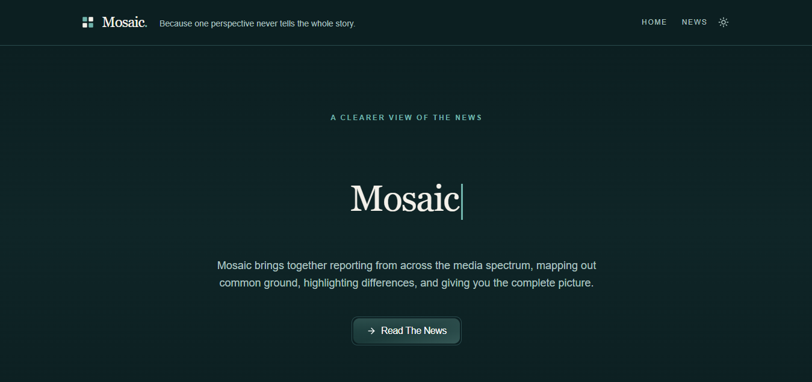
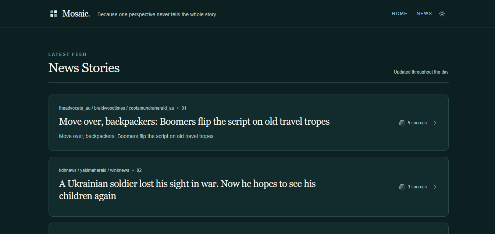
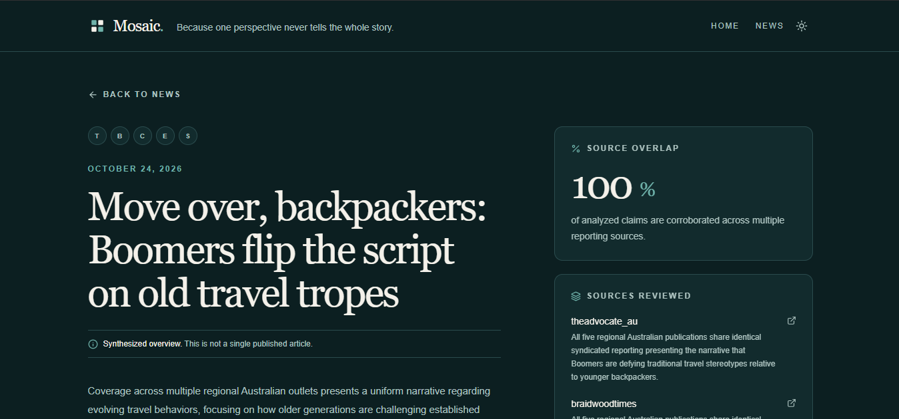
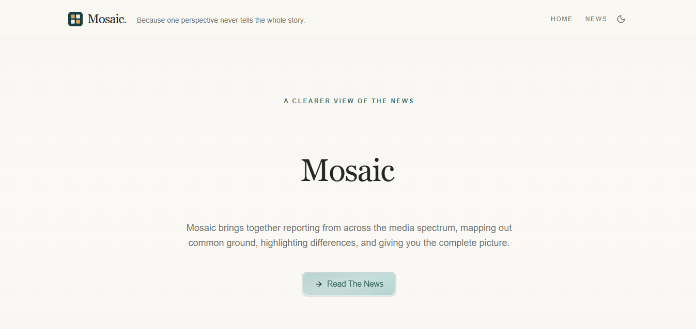

<p align="center">
  <picture>
    <source media="(prefers-color-scheme: dark)" srcset="./public/mosaic-mark-dark.svg">
    
  </picture>
</p>

<h1 align="center">Mosaic</h1>

<h3 align="center">Because one perspective never tells the whole story.</h3>

<p align="center">
  Mosaic brings reporting together, makes common ground visible, and leaves room for the differences that matter.
</p>

<p align="center">
  <a href="https://mosaicnews-web.vercel.app"><strong>Explore Mosaic</strong></a>
  &nbsp;&nbsp;|&nbsp;&nbsp;
  <a href="https://github.com/pro1943/mosaic-api">How the analysis works</a>
</p>

<p align="center">
  
  
  
  
</p>

<br>

<p align="center">
  
</p>

## The news is rarely one story

Every outlet chooses a lens: what leads, what is left out, whose words are quoted, and what context is considered essential. Reading widely is valuable, but it should not require opening ten tabs and mentally reconciling every version yourself.

Mosaic is built for that gap. It follows a developing story across independent reporting outlets and gives the reader a clearer map of the coverage, without pretending disagreement is a problem to be erased.

<table>
  <tr>
    <td width="33%" valign="top">
      <h3>Common ground</h3>
      <p>See the material claims that reporting outlets independently support.</p>
    </td>
    <td width="33%" valign="top">
      <h3>Different lenses</h3>
      <p>Notice where coverage diverges in emphasis, framing, interpretation, and tone.</p>
    </td>
    <td width="33%" valign="top">
      <h3>Original reporting</h3>
      <p>Follow every comparison back to the source articles and make up your own mind.</p>
    </td>
  </tr>
</table>

<br>

## A story, seen from more than one angle

### Start with the coverage

The feed groups reporting about the same event into one considered story card. It foregrounds current, multi-source coverage and shows exactly when the underlying reporting was published.

<p align="center">
  
</p>

### Then follow the evidence

Open a story to see the reporting outlets behind it, the degree of source overlap, and a synthesis that distinguishes shared claims from meaningful differences. Mosaic does not replace the reporting; it makes the path through it easier to follow.

<p align="center">
  
</p>

### Read in the way that suits you

Mosaic keeps the same calm, editorial visual language in light and dark mode, including its mark and favicon.

<p align="center">
  
  
</p>

## Built to stay close to the sources

Mosaic groups recent coverage from independent outlets, compares material claims, calculates the source-overlap percentage from structured comparison data, and links readers back to the original work. It does not declare a source correct or turn disagreement into a verdict.

The web experience is a responsive Next.js application connected to the [Mosaic API](https://github.com/pro1943/mosaic-api), which handles ingestion, clustering, source comparison, and synthesis.

<details>
  <summary><strong>Run the frontend locally</strong></summary>

  <br>

  **Requirements**

  - Node.js 20 or newer
  - pnpm 10 or newer
  - A running Mosaic API instance

  ```powershell
  pnpm install
  Copy-Item .env.example .env
  pnpm dev
  ```

  Open [http://localhost:3000](http://localhost:3000).

  Configure the frontend to use a local API instance with:

  ```env
  NEXT_PUBLIC_MOSAIC_API_URL=http://localhost:3001
  ```

  If the variable is omitted, Mosaic uses the deployed API.
</details>

<details>
  <summary><strong>Frontend stack</strong></summary>

  <br>

  | Area | Technology |
  | --- | --- |
  | Application | Next.js 16, React 19, TypeScript |
  | Interface | Tailwind CSS 4, shadcn/ui, Lucide |
  | Motion | Motion |
  | Analytics | Vercel Analytics |
  | Data layer | Mosaic API and Supabase |
</details>

<details>
  <summary><strong>Commands</strong></summary>

  <br>

  | Command | Description |
  | --- | --- |
  | `pnpm dev` | Start the development server |
  | `pnpm build` | Create a production build |
  | `pnpm start` | Serve the production build |
  | `pnpm typecheck` | Run TypeScript validation |
</details>

<br>

<p align="center">
  <a href="https://mosaicnews-web.vercel.app">mosaicnews-web.vercel.app</a>
</p>
